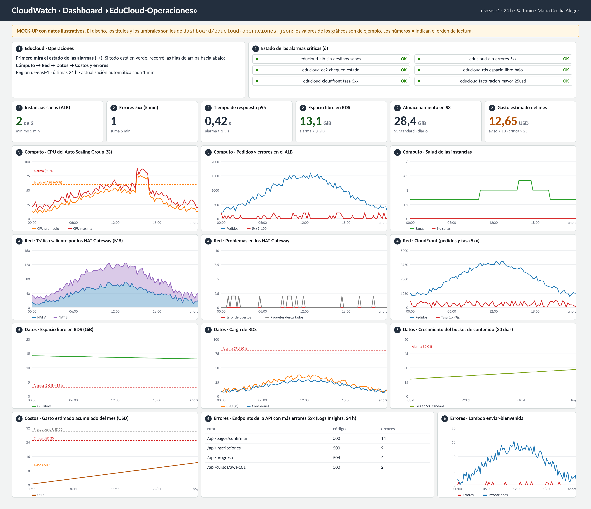

# EduCloud · Plan de monitoreo y auditoría

**Pre-entrega 7** · AWS Cloud Practitioner · Autora: **María Cecilia Alegre**

Este plan cubre la arquitectura de EduCloud de las entregas anteriores: VPC en 2 zonas de disponibilidad (Pre-entrega 6), base de datos RDS (Pre-entrega 5), buckets de S3 (Pre-entrega 4) y capa de cómputo (Pre-entrega 3). Responde tres preguntas:

1. **¿Cómo está la plataforma ahora?** → el dashboard de CloudWatch.
2. **¿Cuándo tengo que actuar?** → la matriz de alarmas, con avisos por SNS.
3. **¿Quién cambió qué?** → CloudTrail y AWS Config.

| Ruta | Qué contiene |
|---|---|
| `README.md` | El plan completo (este documento) |
| `matriz-alarmas.csv` | La matriz de alarmas, para abrir en una planilla |
| `diagramas/dashboard-mockup.png` | Mock-up del dashboard |
| `dashboard/educloud-operaciones.json` | Definición real del dashboard (20 widgets, 36 métricas) |
| `infraestructura/monitoreo-alarmas.yaml` | CloudFormation: 2 temas de SNS, 19 alarmas, filtro de métricas de logs, presupuesto y dashboard |
| `infraestructura/cloudtrail-trail.yaml` | CloudFormation: trail multirregión con eventos de gestión y de datos de S3 |
| `infraestructura/auditoria-config.yaml` | CloudFormation: AWS Config (grabador, 6 reglas y remediación) + 5 reglas de EventBridge sobre eventos de CloudTrail |

Las tres plantillas pasan `cfn-lint` sin errores.

---

## 1. Identificación de recursos y puntos de fallo

| Servicio | Recurso de EduCloud | Punto de fallo | Qué pasa si falla |
|---|---|---|---|
| **EC2 + Auto Scaling** | `educloud-web-asg`: t3.micro, mín. 2 y máx. 6, en las subredes privadas A y B | CPU saturada, instancia con falla de hardware o de sistema operativo | El sitio responde lento o con errores |
| **Application Load Balancer** | `educloud-alb` en las subredes públicas | Sin destinos sanos, errores 5xx de la app | **Sitio caído** para todos |
| **VPC · NAT Gateway** | Un NAT por zona (A y B) | Sin puertos para conexiones salientes, tráfico de salida anómalo | Las EC2 de esa zona no pueden enviar correos (SNS) ni leer secretos |
| **RDS MySQL** | `educloud-mysql`, Multi-AZ, 20 GB | Disco lleno, CPU alta, demasiadas conexiones | **No hay inscripciones ni pagos** |
| **S3** | `educloud-contenido-usuarios-2026-use1` (videos y PDFs) | Crecimiento sin control | Costo más alto |
| **CloudFront** | Distribución de `www.educloud.example` | Errores 5xx en el borde o en el origen | Los usuarios ven errores |
| **Lambda** | `enviar-bienvenida` | Errores al enviar con SES | Los nuevos estudiantes no reciben el correo |
| **Facturación** | Toda la cuenta | Un recurso olvidado o un uso anómalo | **Gasto inesperado** |

## 2. Métricas críticas por servicio

| Servicio | Métrica (namespace) | Qué indica |
|---|---|---|
| EC2 | `CPUUtilization` (AWS/EC2, por ASG) | Qué tan exigidas están las instancias |
| EC2 | `StatusCheckFailed` (AWS/EC2) | 1 si falla el hardware de AWS o el sistema operativo |
| ALB | `HealthyHostCount` / `UnHealthyHostCount` (AWS/ApplicationELB) | Cuántas instancias pasan el health check |
| ALB | `HTTPCode_Target_5XX_Count` | Errores de la aplicación que ven los usuarios |
| ALB | `TargetResponseTime` (p95) | Latencia del 5 % de pedidos más lentos |
| VPC · NAT | `BytesOutToDestination` (AWS/NATGateway) | Tráfico de salida de las subredes privadas, que además se cobra por GB |
| VPC · NAT | `ErrorPortAllocation`, `PacketsDropCount` | El NAT no puede abrir conexiones nuevas o descarta paquetes |
| RDS | `FreeStorageSpace` (AWS/RDS) | Espacio libre en disco, en bytes |
| RDS | `CPUUtilization`, `DatabaseConnections`, `FreeableMemory` | Carga de la base, conexiones abiertas, memoria disponible |
| S3 | `BucketSizeBytes`, `NumberOfObjects` (AWS/S3, diarias) | Consumo de almacenamiento |
| CloudFront | `Requests`, `5xxErrorRate` (AWS/CloudFront, región Global) | Tráfico mundial y tasa de errores |
| Lambda | `Errors`, `Throttles`, `Invocations` (AWS/Lambda) | Ejecuciones con error, limitadas y totales |
| Logs de la app | `ErroresHTTP5xx` (EduCloud/App, filtro de métricas) | Errores de la API leídos del `access_log` de Apache |
| Facturación | `EstimatedCharges` (AWS/Billing, us-east-1) | Gasto acumulado del mes |

## 3. Matriz de alarmas

Todas las alarmas avisan por correo a `admin@example.com` a través de **dos temas de SNS** con distinta urgencia:

- **🔴 Crítica** (`educloud-alertas-criticas`): hay que actuar ya. Avisa **también cuando se resuelve** (`OKActions`).
- **🟠 Aviso y 💲 Costos** (`educloud-alertas-avisos`): hay que revisarlo en el día.

| # | Servicio | Métrica | Condición (umbral) | Período | Severidad | Acción de alerta |
|---|---|---|---|---|---|---|
| 1 | EC2 (Auto Scaling) | `CPUUtilization` (Average) | CPU promedio > 80 % | 3 períodos seguidos de 5 min (15 min) | 🟠 Aviso | Correo a admin@example.com (SNS `educloud-alertas-avisos`) |
| 2 | EC2 (Auto Scaling) | `StatusCheckFailed` (Maximum) | StatusCheckFailed ≥ 1 | 2 períodos de 5 min (10 min) | 🔴 Crítica | Correo a admin@example.com (SNS `educloud-alertas-criticas`) + aviso al resolverse |
| 3 | Application Load Balancer | `HealthyHostCount` (Minimum) | HealthyHostCount < 1 | 2 períodos de 5 min (10 min) | 🔴 Crítica | Correo a admin@example.com (SNS `educloud-alertas-criticas`) + aviso al resolverse |
| 4 | Application Load Balancer | `UnHealthyHostCount` (Maximum) | UnHealthyHostCount ≥ 1 | 3 períodos de 5 min (15 min) | 🟠 Aviso | Correo a admin@example.com (SNS `educloud-alertas-avisos`) |
| 5 | Application Load Balancer | `HTTPCode_Target_5XX_Count` (Sum) | Errores 5xx de la app > 25 | 2 períodos de 5 min (10 min) | 🔴 Crítica | Correo a admin@example.com (SNS `educloud-alertas-criticas`) + aviso al resolverse |
| 6 | Application Load Balancer | `TargetResponseTime` (p95) | Tiempo de respuesta p95 > 1,5 s | 3 períodos de 5 min (15 min) | 🟠 Aviso | Correo a admin@example.com (SNS `educloud-alertas-avisos`) |
| 7 | RDS MySQL | `FreeStorageSpace` (Minimum) | Espacio libre < 3 GiB (15 % de 20 GB) | 2 períodos de 5 min (10 min) | 🔴 Crítica | Correo a admin@example.com (SNS `educloud-alertas-criticas`) + aviso al resolverse |
| 8 | RDS MySQL | `CPUUtilization` (Average) | CPU promedio > 80 % | 3 períodos de 5 min (15 min) | 🟠 Aviso | Correo a admin@example.com (SNS `educloud-alertas-avisos`) |
| 9 | RDS MySQL | `DatabaseConnections` (Maximum) | Conexiones > 60 | 2 períodos de 5 min (10 min) | 🟠 Aviso | Correo a admin@example.com (SNS `educloud-alertas-avisos`) |
| 10 | RDS MySQL | `FreeableMemory` (Average) | Memoria libre < 100 MiB | 3 períodos de 5 min (15 min) | 🟠 Aviso | Correo a admin@example.com (SNS `educloud-alertas-avisos`) |
| 11 | VPC · NAT Gateway | `ErrorPortAllocation` (Sum) | ErrorPortAllocation > 0 (NAT A) | 1 período de 5 min | 🟠 Aviso | Correo a admin@example.com (SNS `educloud-alertas-avisos`) |
| 12 | VPC · NAT Gateway | `ErrorPortAllocation` (Sum) | ErrorPortAllocation > 0 (NAT B) | 1 período de 5 min | 🟠 Aviso | Correo a admin@example.com (SNS `educloud-alertas-avisos`) |
| 13 | VPC · NAT Gateway | `BytesOutToDestination` (Sum) | Más de 5 GiB salientes por hora (NAT A) | 1 período de 1 hora | 💲 Costos | Correo a admin@example.com (SNS `educloud-alertas-avisos`) |
| 14 | CloudFront | `5xxErrorRate` (Average) | Tasa de errores 5xx > 5 % | 2 períodos de 5 min (10 min) | 🔴 Crítica | Correo a admin@example.com (SNS `educloud-alertas-criticas`) + aviso al resolverse |
| 15 | Lambda | `Errors` (Sum) | Errores ≥ 3 | 1 período de 5 min | 🟠 Aviso | Correo a admin@example.com (SNS `educloud-alertas-avisos`) |
| 16 | S3 | `BucketSizeBytes` (Average) | Tamaño en S3 Standard > 50 GiB | 1 día (S3 publica esta métrica una vez por día) | 💲 Costos | Correo a admin@example.com (SNS `educloud-alertas-avisos`) |
| 17 | CloudWatch Logs (app) | `ErroresHTTP5xx` (Sum) | Líneas con código 5xx en el log > 10 | 2 períodos de 5 min (10 min) | 🟠 Aviso | Correo a admin@example.com (SNS `educloud-alertas-avisos`) |
| 18 | Facturación | `EstimatedCharges` (Maximum) | Gasto estimado del mes > USD 10 | 1 período de 6 horas | 💲 Costos | Correo a admin@example.com (SNS `educloud-alertas-avisos`) |
| 19 | Facturación | `EstimatedCharges` (Maximum) | Gasto estimado del mes > USD 25 | 1 período de 6 horas | 🔴 Crítica | Correo a admin@example.com (SNS `educloud-alertas-criticas`) + aviso al resolverse |

Además, **AWS Budgets** (presupuesto `educloud-mensual`, USD 30) avisa cuando el **gasto proyectado** del mes supera el presupuesto, y cuando el gasto **real** pasa del 80 %. Complementa a `EstimatedCharges`, que mide lo que ya se gastó, mientras Budgets anticipa cómo va a terminar el mes.

### Por qué cada umbral

| # | Alarma | Por qué ese umbral |
|---|---|---|
| 1 | `educloud-ec2-cpu-alta` | El Auto Scaling ya agrega instancias al 60 %. Si igual llega al 80 % sostenido, el escalado no alcanza o llegó a su máximo (6). |
| 2 | `educloud-ec2-chequeo-estado` | Una instancia falla el chequeo de hardware o de sistema operativo. El ASG la reemplaza, pero si se repite hay un problema de fondo (AMI, disco, memoria). |
| 3 | `educloud-alb-sin-destinos-sanos` | No queda ninguna instancia sana: el sitio está caído para todos los estudiantes. |
| 4 | `educloud-alb-destinos-no-sanos` | Una instancia falla el health check del ALB por más tiempo del que tarda en reemplazarse: aviso preventivo antes de perder capacidad. |
| 5 | `educloud-alb-errores-5xx` | La aplicación está devolviendo errores a los usuarios (por ejemplo, perdió la conexión con RDS). |
| 6 | `educloud-alb-latencia-p95` | El 5 % de los pedidos más lentos tarda más de 1,5 s: la experiencia se degrada antes de que aparezcan errores. Se usa el percentil 95, no el promedio, porque el promedio esconde a los usuarios más afectados. |
| 7 | `educloud-rds-espacio-libre-bajo` | Si la base se queda sin disco, deja de aceptar escrituras: no hay inscripciones ni pagos. 3 GiB da margen para ampliar el almacenamiento con tiempo. |
| 8 | `educloud-rds-cpu-alta` | Consultas lentas o que faltan índices. Si es sostenido, hay que optimizar o agrandar la clase de instancia. |
| 9 | `educloud-rds-conexiones-altas` | Una db.t4g.micro admite alrededor de 80 conexiones. Por encima de 60 conviene revisar que la app no esté dejando conexiones abiertas. |
| 10 | `educloud-rds-memoria-baja` | Con poca memoria, MySQL lee más del disco y todo se vuelve lento. |
| 11 | `educloud-nat-a-error-puertos` | El NAT se quedó sin puertos para nuevas conexiones salientes: las EC2 de esa zona no pueden llamar a SNS, Secrets Manager ni a internet. Nunca debería pasar, por eso el umbral es 0. |
| 12 | `educloud-nat-b-error-puertos` | Lo mismo, para la zona B. |
| 13 | `educloud-nat-trafico-salida-alto` | El NAT cobra por GB procesado. Tanto tráfico de salida desde subredes privadas no es normal en EduCloud: puede ser una descarga en bucle o una instancia comprometida. |
| 14 | `educloud-cloudfront-tasa-5xx` | Lo que ven los usuarios de todo el mundo: incluye los errores del origen (ALB o S3) y los del propio CloudFront. |
| 15 | `educloud-lambda-bienvenida-errores` | Los nuevos estudiantes no están recibiendo el correo de bienvenida (por ejemplo, SES rechaza los envíos). Un error suelto se reintenta solo, por eso el umbral es 3. |
| 16 | `educloud-s3-contenido-mayor-50gb` | Controla el crecimiento del almacenamiento: si se pasa, conviene revisar que el ciclo de vida de la Pre-entrega 4 esté moviendo los videos viejos a clases más baratas. |
| 17 | `educloud-app-errores-api-logs` | Viene de un filtro de métricas sobre el log de Apache: detecta errores de la API desde adentro del servidor, incluso los que no pasan por el ALB. |
| 18 | `educloud-facturacion-mayor-10usd` | Primer aviso de presupuesto. Esta métrica se publica varias veces por día y solo existe en us-east-1, con las alertas de facturación activadas. |
| 19 | `educloud-facturacion-mayor-25usd` | Se acerca al presupuesto de USD 30: hay que revisar en Cost Explorer qué servicio lo explica. |

### Cómo se evitan las alarmas «ruidosas»

- **Ningún período menor a 5 minutos**, y casi todas piden **2 o 3 períodos seguidos**, de 10 a 15 minutos. Un pico de 1 minuto no despierta a nadie.
- **`DatapointsToAlarm` igual a `EvaluationPeriods`:** todos los períodos tienen que superar el umbral, no solo uno.
- **`TreatMissingData`:**
  - en las métricas de **errores** es `notBreaching`, porque sin tráfico no hay errores;
  - en las de **salud** del ALB es `breaching`, porque si no hay datos de instancias sanas, se asume lo peor;
  - en el resto es `missing`, que deja el estado como estaba.
- **Umbrales escalonados con el Auto Scaling:** el ASG escala al 60 % de CPU, y la alarma salta recién al 80 %. Si salta, es porque el escalado automático no alcanzó.
- **Dos niveles de urgencia**, en dos temas de SNS distintos, para que una alerta crítica no se pierda entre los avisos.

## 4. Mock-up del dashboard



*Mock-up con datos ilustrativos. El JSON real que lo crea está en `dashboard/educloud-operaciones.json` y en la plantilla `monitoreo-alarmas.yaml`.*

**¿Qué veo primero?** El dashboard se lee de arriba hacia abajo, de lo más urgente a lo más detallado. Todos los gráficos muestran las **últimas 24 horas**, salvo S3 y los costos, que muestran 30 días.

| Orden | Fila | Widgets | Para qué |
|---|---|---|---|
| **1** | Estado general | Texto con instrucciones + **estado de las 6 alarmas críticas** (verde o rojo) | De un vistazo: ¿hay que hacer algo ya? |
| **2** | Indicadores clave | 6 números grandes: instancias sanas, errores 5xx, tiempo de respuesta p95, GiB libres en RDS, GiB en S3, **gasto del mes en USD** | La **salud de las instancias**, el **consumo de almacenamiento** y el **gasto**, sin leer gráficos |
| **3** | Cómputo | Líneas: CPU del ASG con las marcas del 60 % y del 80 % · pedidos y errores del ALB · instancias sanas y no sanas | Ver la carga y si coincide con errores |
| **4** | Red | Área apilada: salida por el NAT A y el NAT B · errores de los NAT · pedidos y tasa 5xx de CloudFront | Tráfico de las subredes privadas y lo que ven los usuarios |
| **5** | Datos | Espacio libre en RDS con la marca de 3 GiB · CPU y conexiones de RDS · crecimiento de S3 en 30 días | Anticipar cuándo se llena el disco |
| **6** | Costos y errores | Gasto acumulado con las marcas de 10, 25 y 30 USD · **tabla de Logs Insights con los endpoints de la API con más errores 5xx** · errores de la Lambda | El **gasto proyectado** y los **errores de la API desde los logs** |

La tabla de errores usa esta consulta de **CloudWatch Logs Insights** sobre el log de Apache:

```
SOURCE '/educloud/app'
| parse @message '"* * *" * *' as metodo, ruta, protocolo, codigo, bytes
| filter codigo like /^5/
| stats count(*) as errores by ruta, codigo
| sort errores desc
| limit 10
```

## 5. Plan de auditoría

### 5.1 CloudTrail: quién hizo cada cambio

Se despliega el trail de `infraestructura/cloudtrail-trail.yaml`:

- **Multirregión**, con los eventos globales (IAM) y la **validación de integridad** de los archivos de log activadas.
- **Eventos de gestión:** todos, que es lo que registra cada cambio de infraestructura.
- **Eventos de datos de S3:** las escrituras y los borrados en el bucket de contenido.
- **Retención:** 1 año en un bucket privado, cifrado y versionado.

**Cómo rastrear quién modificó los Security Groups de la Pre-entrega 6:**

1. **En el momento:** la regla de EventBridge `educloud-cambios-criticos-red` escucha los eventos de CloudTrail y manda un correo **a los pocos minutos**, con la acción, el ARN de quien la hizo, la IP y la hora. Por ejemplo:
   > CAMBIO DE RED: AuthorizeSecurityGroupIngress por arn:aws:iam::…:user/pasante desde 198.51.100.23 en us-east-1 a las 2026-11-04T22:47:10Z.
2. **Después, para investigar**, se busca en el historial por Security Group o por acción:
   ```bash
   aws cloudtrail lookup-events --lookup-attributes AttributeKey=ResourceName,AttributeValue=sg-0123456789abcdef0
   aws cloudtrail lookup-events --lookup-attributes AttributeKey=EventName,AttributeValue=AuthorizeSecurityGroupIngress
   ```
   Los campos clave de cada evento son:
   - `userIdentity`: quién;
   - `eventName`: qué hizo;
   - `eventTime`: cuándo;
   - `sourceIPAddress`: desde dónde;
   - `requestParameters`: qué regla agregó exactamente.

**Eventos de CloudTrail que disparan un aviso crítico:**

| Regla de EventBridge | Eventos de CloudTrail | Por qué es crítico |
|---|---|---|
| `educloud-cambios-criticos-red` | `AuthorizeSecurityGroupIngress`/`Egress`, `RevokeSecurityGroup*`, `ModifySecurityGroupRules`, `DeleteSecurityGroup` | Cambia quién puede llegar a las EC2 o a RDS (por ejemplo, abrir el 22 o el 3306 a internet) |
| | `CreateNetworkAclEntry`, `ReplaceNetworkAclEntry`, `DeleteNetworkAclEntry` | Cambia la NACL de una subred: puede abrir o cortar todo el tráfico |
| | `CreateRoute`, `ReplaceRoute`, `DeleteRoute` | Una ruta `0.0.0.0/0 → IGW` en una tabla privada **expone la subred privada** |
| | `DetachInternetGateway`, `DeleteNatGateway`, `DeleteSubnet`, **`DeleteVpc`** | Deja al sitio, o a las subredes privadas, sin conectividad |
| `educloud-manipulacion-auditoria` | `StopLogging`, `DeleteTrail`, `UpdateTrail`, `PutEventSelectors`, `StopConfigurationRecorder`, `DeleteConfigurationRecorder`, `DeleteDeliveryChannel` | Alguien intenta **apagar la auditoría**, que es lo primero que haría un atacante |
| `educloud-cambios-criticos-datos` | `DeleteDBInstance`, `ModifyDBInstance`, `PutBucketPolicy`, `DeleteBucketPolicy`, `PutBucketAcl`, `DeletePublicAccessBlock` | Borrar o exponer la base de datos, o abrir un bucket |
| `educloud-login-root` | `ConsoleLogin` con `userIdentity.type = Root` | El usuario root no debería usarse nunca en el día a día |

### 5.2 AWS Config: cómo quedó cada recurso y si cumple las reglas

**Grabador:** registra solo los tipos de recurso de EduCloud, para controlar el costo:
- red: VPC, subredes, tablas de ruteo, Security Groups, NACL, Internet Gateway y NAT Gateway;
- cómputo: EC2 y ALB;
- datos: RDS y S3;
- auditoría: el trail.

El historial va a un bucket dedicado, con una «foto» completa por día.

**Las tres reglas principales:**

| Regla administrada | Qué garantiza | Relación con las entregas |
|---|---|---|
| **`s3-bucket-public-read-prohibited`** | Ningún bucket de S3 permite lectura pública. Con **remediación automática**: Systems Manager Automation (`AWS-DisableS3BucketPublicReadWrite`) activa Block Public Access | Buckets de la Pre-entrega 4 |
| **`restricted-ssh`** (`INCOMING_SSH_DISABLED`) | Ningún Security Group abre el puerto 22 a `0.0.0.0/0` | Los SG de la Pre-entrega 6 no usan SSH (se entra con Session Manager) |
| **`rds-instance-public-access-check`** | La base de datos nunca es accesible desde internet | `PubliclyAccessible: false` de la Pre-entrega 5 |

**Tres reglas que completan la línea base:** `ec2-instance-no-public-ip` (las EC2 viven en subredes privadas), `rds-storage-encrypted` (cifrado en reposo) y `multi-region-cloudtrail-enabled` (que la auditoría siga encendida).

Cuando un recurso pasa a **NON_COMPLIANT**, la regla de EventBridge `educloud-config-no-conforme` manda un aviso con la regla y el recurso afectado.

### 5.3 Cómo trabajan juntos

Ejemplo: alguien abre el puerto 22 del Security Group de las EC2 a todo internet.

| Servicio | Qué aporta |
|---|---|
| **CloudTrail + EventBridge** | **Quién** fue, desde qué IP y a qué hora. Llega un correo crítico en minutos. |
| **AWS Config** | **Cómo quedó** el Security Group (el antes y el después), y lo marca **NON_COMPLIANT** en `restricted-ssh`. |
| **CloudWatch** | Si el cambio rompe algo (por ejemplo, perder `HealthyHostCount`), salta la alarma de salud. |

## 6. Despliegue, costos y limpieza

**Requisito previo:** en **Billing → Preferencias de facturación**, activar *Recibir alertas de facturación*. Sin eso, `EstimatedCharges` no se publica.

```bash
# Todo en us-east-1, en este orden
aws cloudformation deploy --template-file infraestructura/cloudtrail-trail.yaml   --stack-name educloud-trail
aws cloudformation deploy --template-file infraestructura/monitoreo-alarmas.yaml  --stack-name educloud-monitoreo \
  --parameter-overrides EmailAlertas=admin@example.com NombreAlb=app/educloud-alb/... TargetGroupFullName=targetgroup/educloud-web/... \
                        NatGatewayA=nat-... NatGatewayB=nat-... DistribucionCloudFront=E...
aws cloudformation deploy --template-file infraestructura/auditoria-config.yaml   --stack-name educloud-auditoria --capabilities CAPABILITY_IAM
```

Después hay que **confirmar las dos suscripciones de SNS** desde el correo que manda AWS. Hasta entonces, las alarmas cambian de estado, pero los avisos no llegan.

| Componente | Costo aproximado (us-east-1) |
|---|---|
| 19 alarmas estándar | Las primeras 10 son gratis; las otras 9, USD 0,10 cada una → **~USD 0,90 por mes** |
| Dashboard (36 métricas) | Gratis: la capa gratuita incluye 3 dashboards de hasta 50 métricas |
| SNS por correo | Gratis hasta 1.000 correos por mes |
| CloudTrail | La primera copia de los eventos de gestión es gratis; los eventos de datos cuestan USD 0,10 cada 100.000 |
| AWS Config | USD 0,003 por cambio grabado + USD 0,001 por evaluación de regla → pocos dólares por mes, porque se graban solo 12 tipos de recurso |

**Limpieza:** borrar los tres stacks en orden inverso. Los buckets de logs de CloudTrail y de Config tienen `DeletionPolicy: Retain`, porque los registros de auditoría no conviene perderlos, así que esos se borran a mano si hiciera falta.

## Relación con el AWS Well-Architected Framework

- **Excelencia operativa:**
  - OPS08-BP04 (alertas procesables): se aplica con los umbrales justificados, los dos niveles de urgencia y el aviso cuando se resuelve;
  - OPS08-BP05 (dashboards): se aplica con un panel ordenado por prioridad.
- **Seguridad:** trazabilidad completa (CloudTrail), detección de cambios (Config + EventBridge) y remediación automática.
- **Optimización de costos:** `EstimatedCharges`, AWS Budgets con pronóstico y la alarma de tráfico del NAT.

## Referencias

- AWS, [Métricas de CloudWatch para instancias EC2](https://docs.aws.amazon.com/AWSEC2/latest/UserGuide/viewing_metrics_with_cloudwatch.html).
- AWS, [Create a CloudWatch alarm based on a static threshold](https://docs.aws.amazon.com/AmazonCloudWatch/latest/monitoring/ConsoleAlarms.html).
- AWS, [Dashboard Body Structure and Syntax](https://docs.aws.amazon.com/AmazonCloudWatch/latest/APIReference/CloudWatch-Dashboard-Body-Structure.html).
- AWS, [Filtering data events by using advanced event selectors](https://docs.aws.amazon.com/awscloudtrail/latest/userguide/filtering-data-events.html).
- AWS, [OPS08-BP04 Create actionable alerts](https://docs.aws.amazon.com/wellarchitected/latest/framework/ops_workload_observability_create_alerts.html) y [OPS08-BP05 Create dashboards](https://docs.aws.amazon.com/wellarchitected/latest/operational-excellence-pillar/ops_workload_observability_create_dashboards.html).
- AWS, [AWS Config pricing](https://aws.amazon.com/config/pricing/) · [AWS CloudTrail pricing](https://aws.amazon.com/cloudtrail/pricing/).
